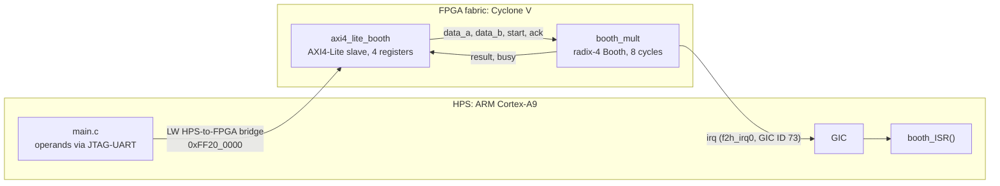
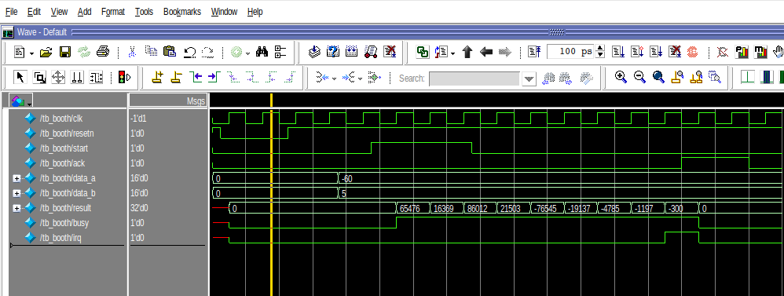
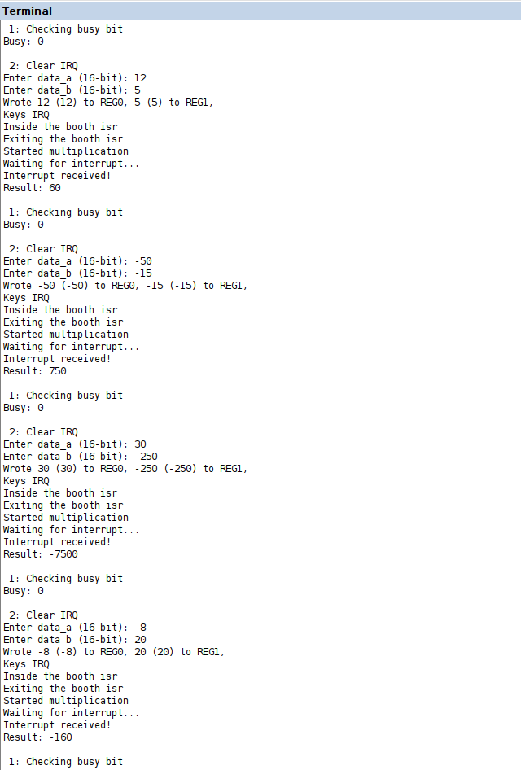

# Radix-4 Booth Multiplier as an AXI4-Lite IP on a Cyclone V SoC

A 16×16-bit signed **radix-4 Booth multiplier** written in SystemVerilog, wrapped as an **AXI4-Lite slave IP** in VHDL and integrated with the **ARM Cortex-A9 HPS** of a DE10-Standard board (Intel Cyclone V SoC). Software on the HPS writes the operands over the lightweight HPS-to-FPGA bridge, starts the multiplication and reads the result when the IP raises an **interrupt**.

- **RTL:** 8-iteration radix-4 Booth datapath with a `start / busy / irq / ack` handshake. `irq` stays high until the processor acknowledges it.
- **SoC integration:** custom Platform Designer component (`_hw.tcl`), four memory-mapped registers at `0xFF20_0000`, and the interrupt routed to the GIC through `f2h_irq0`.
- **Bare-metal C:** GIC setup, IRQ exception handler and an ISR that acknowledges the IP. A console app reads the operands over JTAG-UART.
- **Verification:** self-checking testbench. **20,012 test vectors** pass, covering all sign combinations, the `-32768` corner cases and 20,000 random pairs.
- **Implementation:** the stand-alone multiplier uses **48 ALMs and 38 registers**. The full SoC meets timing at all four corners with a worst-case setup slack of +1.73 ns.

## Architecture



### Register map

| Address | Register | Access | Contents |
|---|---|---|---|
| `0xFF20_0000` | `slv_reg0` | W | `data_a[15:0]` (multiplicand) |
| `0xFF20_0004` | `slv_reg1` | W | `data_b[15:0]` (multiplier) |
| `0xFF20_0008` | `slv_reg2` | R | `result[31:0]` |
| `0xFF20_000C` | `slv_reg3` | R/W | bit 0 `start` (W), bit 1 `busy` (R), bit 2 `ack` (W) |

### How the multiplier works

Radix-4 Booth recoding scans the multiplier three bits at a time, so a 16-bit operand needs only **8 add-and-shift iterations** instead of 16:

| b<sub>i+1</sub> b<sub>i</sub> b<sub>i-1</sub> | Action |
|---|---|
| 000, 111 | +0 |
| 001, 010 | +A |
| 011 | +2A |
| 100 | −2A |
| 101, 110 | −A |

After each addition, the 34-bit product register is shifted right by two with an **arithmetic** shift. Two details matter for signed operands:

- `2A` is built by concatenation (`{M, 1'b0}`) rather than `M <<< 1`. Otherwise the MSB is lost when `data_a = -32768`.
- The shift is forced to be signed with `$signed(...) >>> 2`. Otherwise negative partial products are zero-filled.

The FSM is `IDLE → RUN (8 cycles) → DONE`. `busy` stays high in `RUN` and `DONE`, and `irq` is **held in `DONE` until `ack`**. An earlier version pulsed `irq` for one clock only, which the HPS could miss.

`rtl/booth_mult_38ff.sv` is an area-optimised variant with exactly **38 flip-flops by construction**. Its 4-bit state register doubles as the iteration counter, `busy` and `irq` are decoded from the state, and the Booth window is cut directly from `data_b`. It passes the same test suite.

## Verification

```bash
# Icarus Verilog (12.0)
iverilog -g2012 -o sim rtl/booth_mult.sv tb/tb_booth_mult.sv && vvp sim
# QuestaSim
vlog -sv rtl/booth_mult.sv tb/tb_booth_mult.sv && vsim -c tb_booth_mult -do "run -all"
```

```
--- Radix-4 Booth multiplier: directed tests ---
PASS    : -32768 x -32768 =  1073741824
PASS    : -32768 x  32767 = -1073709056
...
--- 20000 random operand pairs ---
--- 20012 passed, 0 failed ---
ALL TESTS PASSED
```

For each operation, the testbench checks the result against `a*b`. It also checks that `irq` arrives within the expected number of cycles, that `busy` stays high until `ack`, and that both `busy` and `irq` drop after the acknowledge.

| QuestaSim waveform (−60 × 5) | Running on the DE10-Standard |
|---|---|
|  |  |

## Implementation results (Quartus Prime 21.1, Cyclone V)

| Build | Logic | Registers | Timing |
|---|---|---|---|
| `booth_mult` stand-alone | 48 ALMs | 38 | — |
| Full SoC (HPS + AXI IP + JTAG-UART) | n/a | 973 | met at all corners, worst setup slack +1.73 ns |

Results read back on the board: 12 × 5 = 60, −50 × −15 = 750, −8 × 20 = −160, 30 × −250 = −7500.

## Software flow (bare metal, ARM Cortex-A9)

1. Set up the IRQ-mode stack, configure the GIC for the FPGA interrupt, and enable IRQs.
2. Check `busy`, then clear any pending interrupt by pulsing `ack`.
3. Read two signed 16-bit operands from the JTAG-UART and write them to `slv_reg0` and `slv_reg1`.
4. Set `start`, then wait for the flag that `booth_ISR()` sets.
5. In the ISR, pulse `ack` to drop `irq` inside the IP. Back in the main loop, clear `start` and read `slv_reg2`.

## Repository layout

```
rtl/      booth_mult.sv (version used on the board), booth_mult_38ff.sv, axi4_lite_booth.vhd
tb/       tb_booth_mult.sv: self-checking, directed + random
quartus/  Platform Designer system (.qsys), top level, component definition (_hw.tcl)
sw/       main.c, booth_ISR.c, exceptions.c (GIC + vectors), DE10-Standard headers
docs/     lab reports (PDF) and figures
```

## Notes

- The `printf` calls inside the ISR were left in for lab debugging. Production code would drop them, because `printf` is not re-entrant.
- The Quartus files are included for reference. The generated Platform Designer output is not committed.

## Credits

Lab work by **Shahan Antabian** and **Ayush Mohapatra**, High-Level Digital Design, MSc Electronic Engineering, UPC Barcelona (spring 2026). The AXI4-Lite slave skeleton and the exception/GIC start-up code (`exceptions.c`, `address_map_arm.h`, `defines.h`, `interrupt_ID.h`) come from the course materials and the Intel FPGA University Program. We added the multiplier integration, register mapping, IRQ output and ISR.
